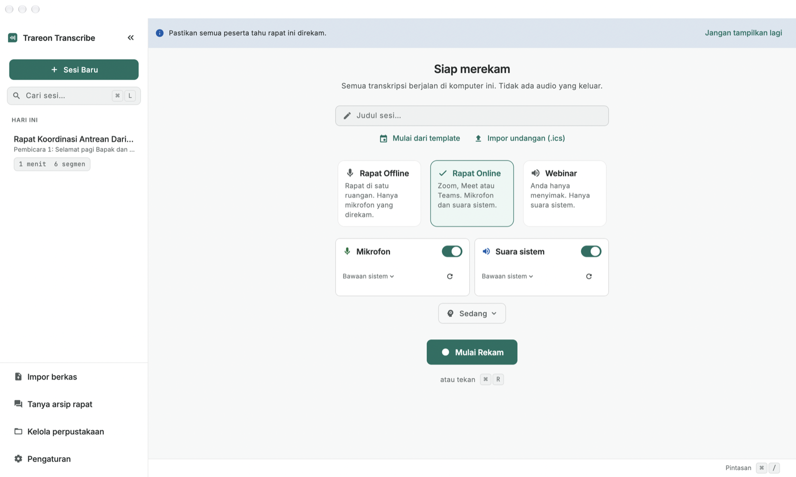
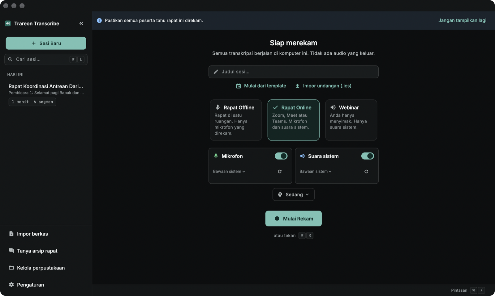
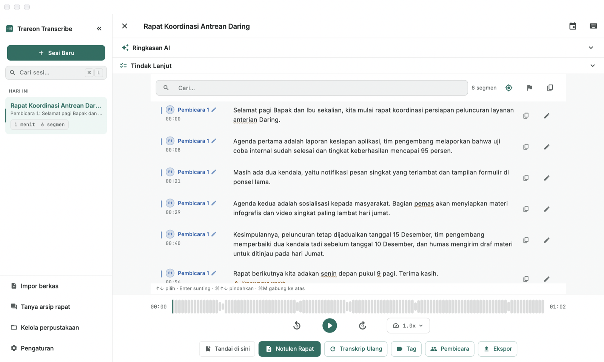
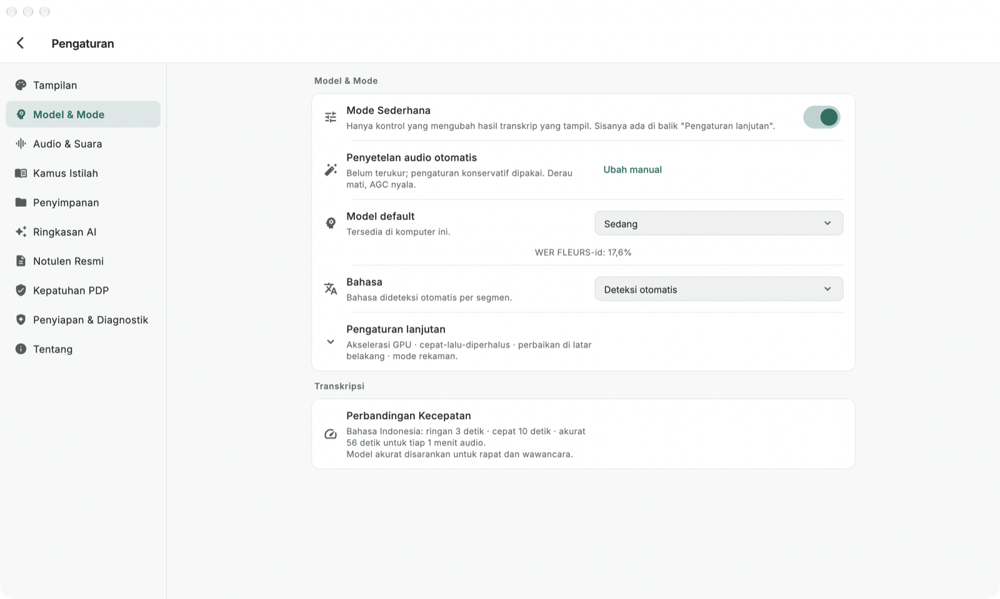
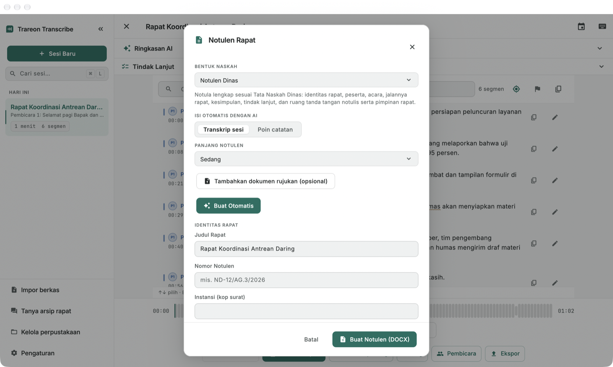
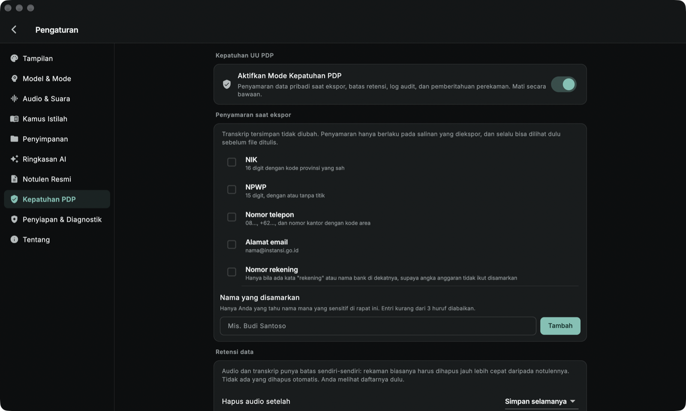

<p align="center">
  
</p>

<h1 align="center">Trareon Transcribe</h1>

<p align="center">
  <strong>Aplikasi transkripsi rapat untuk desktop yang berjalan 100% offline.</strong><br/>
  Rekam mikrofon dan suara sistem, transkripsi lokal dengan Whisper, lalu susun notulen, ringkasan, dan ekspor tanpa audio keluar dari komputer Anda.
</p>

<p align="center">
  <a href="https://github.com/Trareon-com/Trareon-Transcribe/actions/workflows/ci.yml">
    
  </a>
  <a href="https://github.com/Trareon-com/Trareon-Transcribe/releases">
    
  </a>
  <a href="LICENSE">
    
  </a>
  <a href="https://flutter.dev/">
    
  </a>
  <a href="https://www.rust-lang.org/">
    
  </a>
  <a href="https://github.com/ggerganov/whisper.cpp">
    
  </a>
  <br/>
  <a href="#tangkapan-layar">Tangkapan layar</a> •
  <a href="#fitur">Fitur</a> •
  <a href="#model--kualitas-transkripsi">Model</a> •
  <a href="#instalasi">Instalasi</a> •
  <a href="#build-dari-sumber">Build</a> •
  <a href="#arsitektur">Arsitektur</a> •
  <a href="CHANGELOG.md">Changelog</a>
</p>

---

## Tangkapan layar

| Layar utama (terang) | Layar utama (gelap) |
|:---:|:---:|
|  |  |

| Pemutar transkrip | Pengaturan Model & Mode |
|:---:|:---:|
|  |  |

| Pembuat notulen | Mode Kepatuhan UU PDP |
|:---:|:---:|
|  |  |

> Diambil dari build macOS terbaru (`main`, 28 Nov 2026) dengan rekaman demo fiktif.

---

## Fitur

### Privasi lebih dulu

- **Transkripsi 100% lokal.** Rekaman, deteksi suara, diarization, dan ekspor tidak pernah menyentuh jaringan. Uji otomatis (`rust_core/src/privacy.rs`, `test/privacy_proof_test.dart`) menggagalkan build bila ada jalur transkripsi yang memanggil jaringan.
- **Tanpa akun, tanpa telemetri.** Tidak ada analitik, pelaporan crash, atau aktivitas jaringan di latar belakang.
- **Laporan Privasi.** Layar khusus yang mencatat setiap koneksi keluar yang pernah dibuat aplikasi (unduhan model, cek pembaruan manual).
- **Unduhan selalu ditanya dulu.** Saat pertama dibuka, aplikasi menampilkan model yang dibutuhkan beserta ukurannya (±690 MB) dan menunggu persetujuan. Ada pilihan "Nanti" dan "Tunda kalau koneksi metered".
- **Mode Kepatuhan UU PDP (opsional, mati secara default).** Redaksi NIK, NPWP, nomor telepon, email, nomor rekening, dan nama orang pada salinan ekspor (transkrip asli tidak diubah), rencana retensi audio dan transkrip yang selalu dipratinjau sebelum menghapus, log audit lokal append-only, serta teks pemberitahuan rekaman untuk ditempel ke chat rapat.

### Merekam rapat

- **Tiga mode sesi.** *Rapat Offline* (hanya mikrofon), *Rapat Online* (mikrofon + suara sistem untuk Zoom/Meet/Teams), dan *Webinar* (hanya suara sistem).
- **Tangkap suara sistem secara native.** ScreenCaptureKit di macOS 13+ tanpa driver tambahan, WASAPI loopback di Windows, monitor PulseAudio/PipeWire di Linux.
- **Ukur ruangan sebelum merekam.** Dengan "Penyetelan audio otomatis" aktif, aplikasi mendengarkan 3 detik lalu memilih setelan peredam derau (RNNoise) dan penguatan otomatis (AGC). Nilai yang Anda atur sendiri tidak pernah ditimpa.
- **Pembersihan audio.** Peredam derau, AGC, VAD dua tahap, dan penghapus duplikat lintas sumber agar suara speaker yang tertangkap mikrofon tidak tertulis dua kali.
- **Deteksi rapat otomatis.** Saat jendela Zoom, Google Meet, atau Microsoft Teams terdeteksi, aplikasi menawarkan untuk mulai merekam. Rekaman bisa berhenti otomatis setelah sunyi panjang.
- **Tahan gangguan.** Jeda/lanjutkan, rekaman tetap jalan saat jendela diminimalkan ke tray, sesi otomatis dipecah per jam atau saat memori menipis, perangkat audio yang tersambung ulang dilanjutkan, dan sesi yang terputus bisa dipulihkan saat aplikasi dibuka lagi.
- **Catatan pribadi saat rapat.** Panel catatan di samping transkrip langsung, tersimpan otomatis.
- **Tanya Langsung.** Ajukan pertanyaan tentang rapat yang sedang berjalan, dijawab dari transkrip yang sedang tumbuh lengkap dengan kutipan dan timestamp.

### Transkripsi

- **Whisper lokal** via `whisper-rs` (whisper.cpp), dengan akselerasi Metal/Core ML di macOS dan Vulkan opsional di Windows/Linux. Wizard penyiapan mengukur GPU vs CPU di perangkat Anda lalu memilih yang lebih cepat.
- **Enam pilihan kualitas.** Otomatis, Cepat, Sedang, Akurat, plus dua tingkat *Eksperimental* berbasis CrispASR/Qwen3-ASR. Lihat [Model & kualitas transkripsi](#model--kualitas-transkripsi).
- **Cepat dulu, lalu diperhalus.** Hasil awal dari model ringan langsung tampil, lalu diperbaiki di latar belakang oleh model yang lebih akurat.
- **Kamus istilah (glosarium).** Istilah, nama, dan singkatan instansi dipakai untuk memandu Whisper dan mengoreksi ejaan setelah inferensi. Aplikasi juga bisa mengusulkan istilah baru dari koreksi Anda.
- **Penangkal halusinasi.** Kata dengan keyakinan rendah digarisbawahi, dan keluaran berulang khas Whisper pada bagian hening disaring.
- **Diarization.** Pemisahan pembicara berbasis klaster fitur akustik, dengan opsi model neural (sherpa-onnx). Pembicara bisa diberi nama dan digabung lewat Kelola Pembicara.
- **Impor berkas.** Seret-lepas MP3, AAC, MP4/M4A, OGG, FLAC, WAV, dan format lain yang didukung Symphonia untuk transkripsi batch. Sesi lama bisa ditranskripsi ulang dengan model lain.

### Setelah rapat

- **Pemutar transkrip.** Klik kata untuk lompat ke audio, sorotan ala karaoke, ubah kecepatan, sunting teks langsung, penanda (bookmark), dan tag sesi.
- **Ringkasan AI dan "Enhance".** Ringkasan memakai LLM yang Anda jalankan sendiri, yaitu [Ollama](https://ollama.com/download) di `localhost` atau endpoint kompatibel OpenAI pilihan Anda. Enhance menggabungkan catatan pribadi dengan transkrip. Wizard penyiapan model AI memandu instalasi Ollama dan memilih model sesuai perangkat keras.
- **Notulen rapat.** Bentuk naskah Notulen Dinas (sesuai Tata Naskah Dinas), Risalah Rapat, Berita Acara, dan Notulen Ringkas, diisi otomatis dari transkrip atau poin catatan. Pratinjau menampilkan hasil *Periksa Fakta* per butir, dan *Rapikan Ragam* (EYD V dan istilah kedinasan) yang perubahannya harus Anda terima satu per satu.
- **Ekspor ke SRIKANDI.** Formulir metadata naskah dinas lengkap dengan validasi Wajib/Saran, menghasilkan DOCX, PDF, metadata JSON, dan CSV siap unggah.
- **Tindak lanjut.** Daftar butir tindakan terstruktur, bisa diekspor sebagai acara kalender `.ics`. Undangan rapat `.ics` juga bisa diimpor untuk mengisi judul dan peserta.
- **Tanya Arsip Rapat.** Cari dan tanyakan isi semua rapat lama lewat indeks teks penuh SQLite FTS5 lokal, dengan pencarian semantik opsional.
- **Ekspor dan berbagi.** Markdown, TXT, JSON, SRT, VTT, HTML, DOCX, CSV, dan PDF, plus audio rekaman (WAV). Tombol Bagikan memakai menu berbagi bawaan sistem.
- **Arsip lintas perangkat.** Ekspor sesi lengkap ke `.zip` dan impor di komputer lain.

### Tampilan dan kenyamanan

- **Bahasa Indonesia dan Inggris.** Seluruh antarmuka bisa diganti di Pengaturan → Tampilan (Sistem, Indonesia, atau English).
- **Mode Sederhana.** Hanya kontrol yang memengaruhi hasil transkrip yang tampil, sisanya ada di balik "Pengaturan lanjutan".
- **Tema terang, gelap, atau ikut sistem**, sidebar sesi yang bisa diciutkan, dan pintasan keyboard. Di macOS, `Ctrl + Shift + R` dan `Ctrl + Shift + P` tetap bekerja saat aplikasi di latar belakang.
- **Aksesibilitas.** Label semantik untuk pembaca layar, navigasi fokus dengan keyboard, dan target sentuh minimal 24×24 pt (WCAG 2.2 AA).
- **Diagnostik.** Pemeriksaan kesehatan rekaman, flight recorder lokal, dan "Simpan log diagnostik" untuk melaporkan masalah tanpa mengirim apa pun secara otomatis.

---

## Model & kualitas transkripsi

Pilihan kualitas ada di wizard penyiapan, Pengaturan, dan chip di dekat tombol **Mulai Rekam**. Tingkat dipilih sekali di awal sesi.

| Pilihan | Mesin | Model | Ukuran | WER FLEURS-id | Catatan |
|:--|:--|:--|--:|--:|:--|
| **Otomatis** | Whisper | dipilih dari RAM perangkat | — | — | Ditawarkan di wizard penyiapan. Selalu jatuh ke tingkat non-eksperimental |
| **Cepat** | Whisper | `base` | 142 MB | 36,7% | Ringan, jalan di hampir semua perangkat |
| **Sedang** | Whisper | `small` | 466 MB | 17,6% | Diunduh saat dipilih |
| **Akurat** | Whisper | `large-v3-turbo-q5` | 548 MB | 8,1% | Disarankan untuk rapat dan wawancara |
| **Cepat-Eksperimental** | CrispASR | Qwen3-ASR 0.6B | 631 MB | 8,6% | Tetap real-time di CPU |
| **Akurat-Eksperimental** | CrispASR | Qwen3-ASR 1.7B | 1,5 GB | 5,3% | Akurasi terbaik, butuh GPU agar nyaman |

WER (word error rate) diukur pada 687 ujaran FLEURS bahasa Indonesia; makin kecil makin baik. Angka yang sama tampil di Pengaturan saat memilih model. Metode dan cara mengulang pengukuran ada di [`docs/WER-BENCH.md`](docs/WER-BENCH.md), dan riset model khusus bahasa Indonesia ada di [`docs/INDONESIAN-MODEL.md`](docs/INDONESIAN-MODEL.md).

Tingkat eksperimental tidak pernah dipilih otomatis. Bila mesinnya gagal dimuat, sesi kembali ke **Cepat** (Whisper `base`) tanpa crash.

**Lokasi model.** Paket rilis membawa `base` dan `large-v3-turbo-q5`. Model lain (`tiny`, `small`, `medium`, `large-v3-turbo`, Qwen3-ASR, Silero VAD, dan model diarization neural) diunduh sekali dari Pengaturan, diverifikasi SHA-256, lalu dipakai offline selamanya. Aplikasi mencari model di:

- macOS: `~/Library/Caches/TrareonTranscribe/models` dan `Contents/Resources/models` di dalam bundle aplikasi
- Linux: `~/.cache/TrareonTranscribe/models`
- Windows: `%LOCALAPPDATA%\TrareonTranscribe\models`
- folder `models/` di sebelah berkas biner

---

## Instalasi

Unduh paket dari [halaman Releases](https://github.com/Trareon-com/Trareon-Transcribe/releases). Rilis terbaru saat ini adalah seri **v1.1.0-beta**.

| Platform | Paket | Catatan |
|:--|:--|:--|
| macOS 12+ (Apple Silicon & Intel) | `.dmg` | Tanpa sertifikat Developer ID, klik kanan → **Open** saat pertama kali dibuka. Izinkan *Microphone* dan *Screen & System Audio Recording* saat diminta |
| Windows (x64) | `.zip` dan installer `.exe` | SmartScreen bisa muncul karena sertifikat self-signed |
| Linux (x86_64) | `.tar.gz`, `.AppImage`, `.deb` | `.deb` tidak membawa model, model diunduh saat pertama dibuka |

Setiap rilis menyertakan `SHA256SUMS` untuk memeriksa keaslian berkas. Fitur ringkasan dan notulen AI butuh [Ollama](https://ollama.com/download) (opsional). Tanpa Ollama, seluruh fitur rekam, transkripsi, dan ekspor tetap berfungsi penuh.

---

## Build dari sumber

### Prasyarat

| Kebutuhan | Versi | Catatan |
|:--|:--|:--|
| [Flutter](https://flutter.dev/) | 3.50+ (stable) | CI memakai 3.50.1 |
| [Rust](https://www.rust-lang.org/) | stable terbaru | `cmake` harus ada di PATH untuk mengompilasi whisper.cpp |
| macOS | Xcode dengan Command Line Tools | target minimum macOS 12.0 |
| Windows | Visual Studio 2022 Build Tools | workload *Desktop development with C++* |
| Linux | — | `pkg-config`, `libasound2-dev`, `libgtk-3-dev`, `liblzma-dev`, `ninja-build`, `clang`, serta `ffmpeg` atau `parec` untuk suara sistem |

### Jalankan untuk pengembangan

```bash
git clone https://github.com/Trareon-com/Trareon-Transcribe.git
cd Trareon-Transcribe
flutter pub get

# Mesin Rust (ulangi setiap kali rust_core berubah)
(cd rust_core && cargo build --release --lib)

flutter run -d macos     # atau: -d windows, -d linux
```

Di macOS, build Xcode sudah menjalankan `cargo build` sendiri (dengan fitur `crispasr-experimental`) dan menyalin `librust_core.dylib` ke bundle.

### Paket distribusi

```bash
bash scripts/package_macos.sh "1.1.0"         # DMG universal; Developer ID + notarisasi bila MACOS_SIGN_IDENTITY diset
bash scripts/package_linux.sh "1.1.0"         # tar.gz + AppImage
bash scripts/package_deb.sh "1.1.0"           # .deb (tambahkan --with-models untuk lingkungan air-gapped)
.\scripts\package_windows.ps1 -Version "1.1.0"  # ZIP (PowerShell)
```

Semua hasil masuk ke `dist/` beserta checksum SHA-256. Rilis resmi dibuat oleh workflow `release.yml` saat tag `v*` didorong. Detail tiap paket ada di [`DISTRIBUTION.md`](DISTRIBUTION.md).

### Fitur Cargo opsional

| Fitur | Isi |
|:--|:--|
| `crispasr-experimental` | Tingkat Eksperimental Qwen3-ASR via CrispASR (aktif di build macOS) |
| `gpu-vulkan` | Akselerasi GPU lintas vendor via Vulkan |
| `neural-diarization` | Diarization neural dengan sherpa-onnx |
| `semantic-embedding` | Pencarian semantik di Tanya Arsip Rapat |
| `silero-onnx` | VAD Silero via ONNX Runtime |

### CLI transkripsi batch

```bash
cd rust_core
cargo run --release --bin trareon-transcribe -- \
  --batch "rekaman/*.mp3" \
  --output ./transkrip \
  --model ../models/ggml-base.bin \
  --format md,txt,srt,docx \
  --glossary istilah.txt
```

Opsi lain: `--language id`, `--gpu`, `--denoise`, `--no-vad`. Format yang didukung: `md,txt,json,srt,vtt,html,docx,csv,pdf`. Biner pembantu lain ada di `rust_core/src/bin/` (`device_probe`, `input_probe`, `dual_capture_probe`, `wer_bench`, `live_bench`, `gen_fixtures`).

### Tes

```bash
(cd rust_core && cargo fmt --check && cargo clippy && cargo test --lib)
flutter analyze && flutter test
```

---

## Arsitektur

Antarmuka Flutter berbicara dengan mesin Rust lewat `flutter_rust_bridge`. Seluruh pemrosesan audio dan teks terjadi di Rust.

```
lib/                     Antarmuka Flutter (Dart, Riverpod)
├── screens/             Layar utama, pustaka, pemutar, pengaturan, wizard,
│                        Tanya Arsip, Laporan Privasi, diagnostik
├── widgets/             Panel transkrip, notulen, ringkasan, SRIKANDI, dsb.
├── state/               Notifier Riverpod dan model data
├── services/            Bridge, tray, jendela, hotkey, arsip sesi, update
├── l10n/                String UI Indonesia (templat) dan Inggris
└── theme/               Token warna, tipografi, gerak, pintasan

rust_core/src/           Mesin Rust
├── api.rs               Permukaan FFI (titik masuk flutter_rust_bridge)
├── audio/               Perangkat, tangkap mic + loopback, probe level
├── decode/              Dekode berkas (Symphonia) + resample (rubato)
├── pipeline.rs          Pipeline transkripsi live dan progresif
├── model.rs             Katalog model, unduhan, verifikasi SHA-256
├── model_select.rs      Enam tingkat kualitas dan resolusi "Otomatis"
├── diarization/         Klaster akustik + sherpa-onnx opsional
├── denoise.rs, agc.rs,  Pembersihan audio
│   silence_gate.rs
├── summary.rs, live_qa.rs, semantic_search.rs   Fitur LLM lokal
├── notulen/             Skema, prompt, periksa fakta, ragam bahasa
├── srikandi.rs          Metadata dan paket ekspor SRIKANDI
├── pdp/                 Redaksi, retensi, log audit (UU PDP)
├── export/              Writer semua format ekspor
├── session.rs           Registri sesi, pemecahan otomatis, pemulihan
├── privacy.rs           Uji "tanpa jaringan" yang menjaga janji privasi
└── bin/                 CLI dan alat ukur
```

Penjelasan lengkap, diagram alur data, dan detail bridge ada di [`ARCHITECTURE.md`](ARCHITECTURE.md).

### Tech stack

| Lapisan | Teknologi |
|:--|:--|
| UI | Flutter 3.50+, Riverpod 3, `material_ui`/`cupertino_ui`, flutter_rust_bridge 2.13 |
| Mesin | Rust edisi 2021 |
| STT | whisper.cpp via `whisper-rs` 0.16, CrispASR/Qwen3-ASR (eksperimental) |
| Audio | `cpal`, ScreenCaptureKit (macOS), WASAPI (Windows), PulseAudio/PipeWire (Linux) |
| Dekode | Symphonia + rubato, Rust murni tanpa ffmpeg |
| Pembersihan | RNNoise (`nnnoiseless`), WebRTC VAD, Silero VAD |
| Penyimpanan | SQLite (FTS5) + `sqlite-vec` untuk arsip rapat |
| Ekspor | DOCX dan arsip (`zip`), PDF (`printpdf`), WAV (`hound`) |

---

## Dukungan platform

| Fitur | macOS | Windows | Linux |
|:--|:--:|:--:|:--:|
| Rekam mikrofon + suara sistem | ✅ | ✅ | ✅ |
| Transkripsi Whisper | ✅ (Metal) | ✅ | ✅ |
| Tingkat Eksperimental (CrispASR) | ✅ | — | — |
| Impor berkas dan CLI | ✅ | ✅ | ✅ |
| Semua format ekspor | ✅ | ✅ | ✅ |
| Paket rilis | DMG | ZIP + installer | tar.gz, AppImage, .deb |
| Build di CI | ✅ | ✅ | ✅ |

---

## Pintasan keyboard

Di macOS pakai `⌘`, di Windows dan Linux pakai `Ctrl`. Daftar lengkap bisa dibuka dengan `⌘/Ctrl + /`.

| Pintasan | Aksi |
|:--|:--|
| `⌘/Ctrl + R` | Mulai / hentikan rekaman |
| `⌘/Ctrl + P` | Jeda / lanjutkan |
| `⌘/Ctrl + L` | Cari sesi |
| `⌘/Ctrl + B` | Tambah penanda (bookmark) |
| `⌘/Ctrl + ,` | Buka Pengaturan |
| `⌘/Ctrl + /` | Tampilkan panel pintasan |
| `⌘/Ctrl + Shift + S` | Ciutkan / tampilkan sidebar |

---

## Batasan yang diketahui

- **Peringatan Gatekeeper dan SmartScreen.** Build tanpa sertifikat Developer ID (macOS) atau dengan sertifikat self-signed (Windows) memunculkan peringatan saat pertama dibuka.
- **Belum ada pembaruan otomatis.** Cek versi baru secara manual lewat Pengaturan. Pengecekan ini satu-satunya koneksi selain unduhan model, dan tercatat di Laporan Privasi.
- **Tingkat Eksperimental** masih dalam pengujian dan saat ini hanya tersedia di build macOS.
- **Fitur AI** (ringkasan, notulen, Tanya Langsung, Tanya Arsip) bergantung pada LLM lokal yang Anda pasang sendiri, sehingga kualitas dan kecepatannya mengikuti model dan perangkat Anda.

---

## FAQ

**Apakah audio saya dikirim ke cloud?**
Tidak. Rekaman dan transkripsi, baik live maupun dari berkas, berjalan sepenuhnya di komputer Anda. Fitur AI hanya mengirim teks transkrip ke LLM yang Anda jalankan sendiri (default Ollama di `localhost`), tidak pernah audio.

**Apakah ada telemetri?**
Tidak ada telemetri, analitik, atau pelaporan crash. Log diagnostik hanya dibuat saat Anda menekan "Simpan log diagnostik", dan tidak dikirim ke mana pun.

**Apakah aplikasi ini sudah tersertifikasi ISO/IEC 27001 atau terdaftar PSE?**
Belum. [`docs/compliance/`](docs/compliance/) berisi bahan kerja untuk audit internal instansi (pemetaan UU PDP, ISO/IEC 27001/27701, templat DPIA, prosedur retensi), bukan sertifikasi.

**Bagaimana cara mendapatkan binari siap pakai?**
Kode sumber berlisensi MIT dan rilis tersedia di GitHub. Informasi saluran distribusi berbayar ada di [`DISTRIBUTION.md`](DISTRIBUTION.md).

---

## Kontribusi dan keamanan

- Panduan kontribusi, konvensi commit, dan alur PR ada di [`CONTRIBUTING.md`](CONTRIBUTING.md).
- Laporkan kerentanan lewat GitHub Security Advisory sesuai [`SECURITY.md`](SECURITY.md). CI menjalankan `cargo audit`, `cargo deny`, clippy, dan audit dependensi mingguan.
- Lisensi pihak ketiga tercantum di [`THIRD_PARTY_LICENSES.md`](THIRD_PARTY_LICENSES.md).

## Lisensi

MIT, lihat [`LICENSE`](LICENSE). Hak cipta © 2026 [Trareon.com](https://trareon.com).
